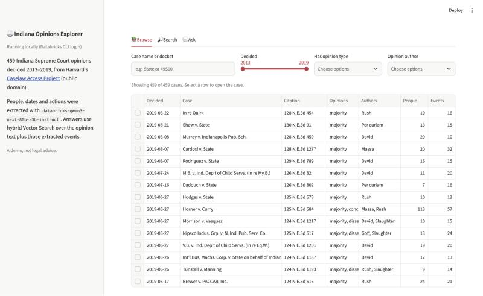
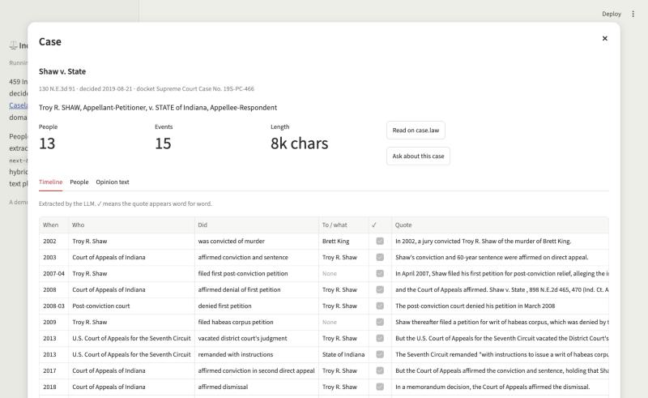
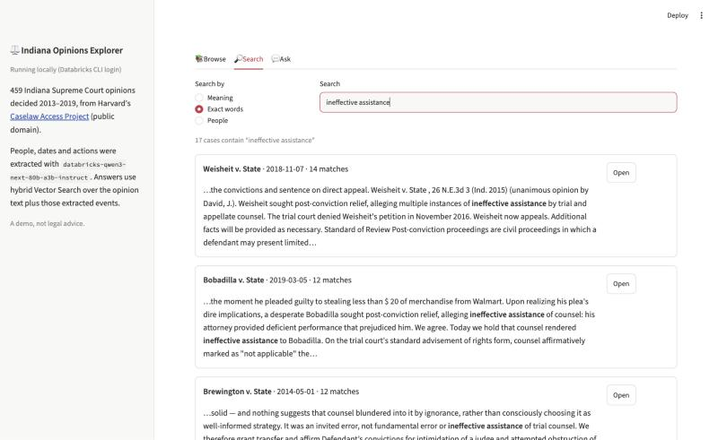
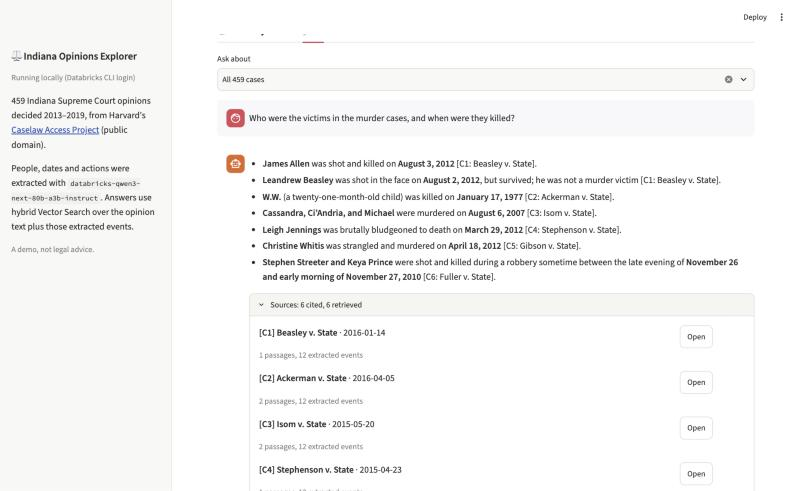

# Legal Data Demo

Browse, search and ask questions about **459 Indiana Supreme Court opinions** (2013–2019). An LLM
pulled the **people, dates and actions** out of every opinion, and the chat answers questions
from those facts plus the opinion text, citing the case behind each claim.

**Stack:** Python 3.12 · Databricks (Unity Catalog, Vector Search, Foundation Model APIs, Apps,
Jobs) · Streamlit · GitHub Actions

| Browse | Case detail |
|---|---|
|  |  |
| **Search** | **Ask** |
|  |  |

## What it does
- **Log in:** a Databricks App behind workspace single sign-on. Only people given access can
  open it, and the sidebar shows who is signed in.
- **Browse:** all 459 cases, filtered by name or docket, year, opinion type and author. Open a
  case to see its timeline of extracted events, the people involved, the full opinion and a
  link to case.law.
- **Search:** by meaning (hybrid vector + keyword search), by exact words (highlighted), or by
  person.
- **Ask:** questions about who did what, and when. Answers stream in a couple of seconds and cite
  each case, like `[C1: Beasley v. State]`. A case's **Ask about this case** button limits the
  chat to that case.

## 5-minute demo script
1. **Sign-in and data (30s).** Open the app and point out the "Signed in as" line. The sidebar
   names the data: public-domain opinions from Harvard's Caselaw Access Project.
2. **Browse (1 min).** Show the filters (for example, opinions with a *dissent*, or by Justice
   *Rush*), then clear them and open **Shaw v. State** (2019-08-21): its timeline runs from a
   2002 murder conviction through habeas petitions to 2019, and ✓ marks quotes found word for
   word in the opinion.
3. **Search (1 min).** *Exact words*: `ineffective assistance` (17 cases, highlighted).
   *Meaning*: `police searched a car without a warrant` finds traffic-stop and search cases by
   what they're about, not just matching words. *People*: `Rush`.
4. **Ask (2 min).** Click the example *"Who were the victims in the murder cases, and when were
   they killed?"*: a list of names and exact dates, each cited. Open **Sources** and **Open** a
   case. Then ask *"What crimes happened in 2012, and who was involved?"*, which uses the
   extracted event dates, not just the decision dates.
5. **One case (30s).** On a case, click **Ask about this case**, then ask *"Give me a timeline of
   what happened in this case."*

## How it works
```
laptop: scripts/download_cap.py ──► UC Volume raw.cap (459 JSON opinions)
                                          │
Databricks Job legal-data-pipeline        ▼
  transform ──► silver.documents, silver.chunks (4,723 chunks of ~3,000 chars)
  extract   ──► LLM (Qwen3-Next 80B) reads each opinion in 24k-char segments
                ──► gold.entities (7,663 people/orgs), gold.events (7,906 dated actions,
                    84% with quotes verified word for word)
  index     ──► Vector Search Delta Sync index on chunks (gte-large embeddings)
  validate  ──► counts, consistency and quote checks
                                          │
Databricks App (Streamlit) ◄──────────────┘
  Ask = hybrid passage search (Vector Search) fused with a keyword ranking of whole cases (SQL,
  rare words weigh more) ──► top 6 cases ──► their passages + gold.events (+ events dated in
  any year the question names) ──► chat model, told to cite [C#] and never invent dates
```
More detail: [docs/PLAN.md](docs/PLAN.md) (decisions and what changed in each phase) and
[notebooks/README.md](notebooks/README.md).

## Evaluation
[eval/questions.jsonl](eval/questions.jsonl) holds 20 questions about specific people, dates and
actions, each with the case that answers it and the facts the answer must contain. All were
written from quotes the pipeline verified in the opinions.
```bash
uv run python scripts/run_eval.py      # writes eval/results.md; fails below 80% of facts found
```
Latest results ([eval/results.md](eval/results.md)): **20/20** answers contain every expected
fact and cite the right case. (Before the keyword ranking described above was added, q03 was a
search miss at 19/20: the model said its sources didn't cover it rather than guessing.)

## Run it yourself
### Local setup
If the repo is inside an iCloud-synced folder (such as `~/Documents`), iCloud sets the macOS
"hidden" flag on `.venv`, and Python then skips its `.pth` files, which breaks
`import legal_demo`. Keep the environment in a folder iCloud ignores:
```bash
mkdir .venv.nosync && ln -s .venv.nosync .venv
```

```bash
uv sync --group dev        # creates .venv with Python 3.12 and all dependencies
uv run pytest              # run tests
uv run ruff check .        # lint
uv run python scripts/smoke_test_app.py   # drive the real app headless (uses your Databricks login)
```

### Data
```bash
uv run python scripts/download_cap.py --upload   # download 459 Indiana Supreme Court opinions, upload to UC
```
See [data/README.md](data/README.md) for the source, filter and layout.

### Pipeline
```bash
scripts/deploy.sh dev                                  # copy src/legal_demo to a UC Volume, deploy the bundle
databricks bundle run -t dev legal_pipeline            # transform → extract + index → validate
databricks bundle run -t dev legal_pipeline --params max_docs=5   # quick test on 5 cases
```
Use `scripts/deploy.sh` rather than `databricks bundle deploy`: the notebooks import the shared
code from a Volume (see [notebooks/README.md](notebooks/README.md)).

### App
```bash
uv run streamlit run app/app.py                    # run locally with your Databricks CLI login
scripts/deploy.sh dev && databricks bundle run -t dev legal_app   # deploy, then (re)start the dev app
```
The demo app is `legal-demo`, deployed to the `prod` target by GitHub Actions on every merge to
`main`. Your own dev copy is `legal-demo-dev`. Each app runs as its own service principal, with
access to the warehouse, model endpoints, tables and Vector Search index granted in
`databricks.yml`.

### Sharing the demo
People can open the app if they are users in the Databricks workspace and members of the
`legal-demo-users` group, which `databricks.yml` gives CAN_USE on the app (open it, nothing
more; the app reads data as its own service principal). To add someone, as a workspace admin:
**Settings → Identity and access → Groups → legal-demo-users → Add members** (invite them to the
workspace first if they aren't a user yet). Then send them the app URL.

### CI/CD
Every pull request and push runs ruff and pytest. After CI passes on `main`, GitHub Actions
deploys the `prod` target as the `legal-data-demo-ci` service principal, deploys the app's code
and checks that the app is running. `scripts/grant_ci.sh` sets up that service principal's
permissions (run once, as an admin).

## Layout
```
databricks.yml      Databricks Asset Bundle: pipeline job and app, dev and prod targets
src/legal_demo/     shared pipeline code (CAP download, parsing, chunking, extraction prompt)
notebooks/          pipeline notebooks (transform → extract + index → validate)
app/                Streamlit app: app.py (UI), backend.py (data and model), rag.py (prompting)
eval/               evaluation questions and latest results
scripts/            download, deploy, permissions, app checks, evaluation and app smoke test
tests/              pytest tests
docs/               plan and screenshots
```
